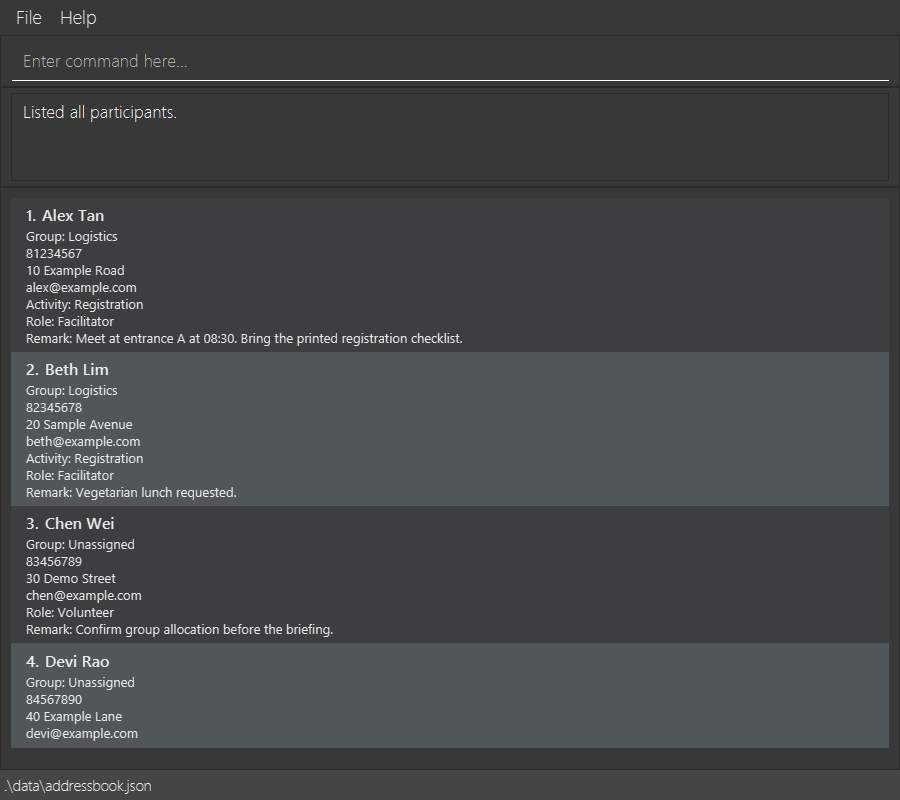

# ZoomAddress

*Integrated v1.5 candidate captured from the packaged JavaFX application with synthetic data; OS window
decorations are omitted. This candidate is not yet published. See the
[releases](https://github.com/AY2627S1-CS2103T-W13-2/tp/releases) for available downloads.*

ZoomAddress is a desktop participant-management application for directors of large-scale computing events, such as
orientation camps. It helps event directors keep track of participants and their relevant information, making it
easier to coordinate people across different groups, roles, and activities.

ZoomAddress is designed for fast, keyboard-driven workflows and stores participant data locally without relying on a
remote service.

## Features

* Create, view, find, and remove participant records.
* Sort the currently displayed participants by name without changing stored records.
* Assign participants to groups, roles, and activities.
* Record, replace, or clear participant remarks and read them on participant cards.
* Retrieve participant details and assignment information quickly.
* Save and load participant data locally and automatically.
* Perform common operations efficiently using typed commands.
* Find incomplete group, role, or activity allocations and combine assignment criteria in one query.

## Documentation

* [Product website](https://ay2627s1-cs2103t-w13-2.github.io/tp/)
* [User Guide](https://ay2627s1-cs2103t-w13-2.github.io/tp/UserGuide.html)
* [Developer Guide](https://ay2627s1-cs2103t-w13-2.github.io/tp/DeveloperGuide.html)
* [Team repository](https://github.com/AY2627S1-CS2103T-W13-2/tp)

## Acknowledgements

ZoomAddress is based on the
[AddressBook-Level3 project](https://github.com/se-edu/addressbook-level3) created by the
[SE-EDU initiative](https://se-education.org/).
