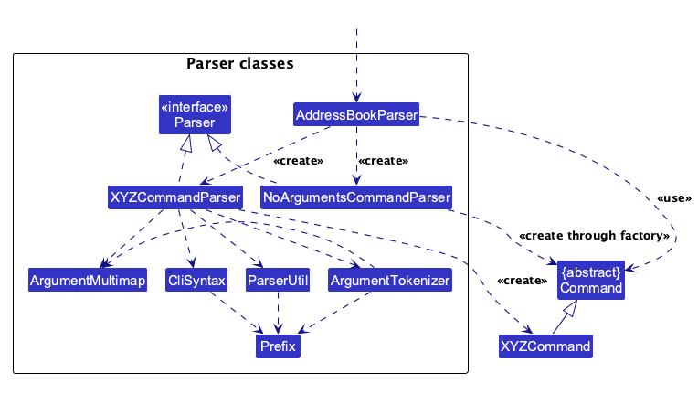
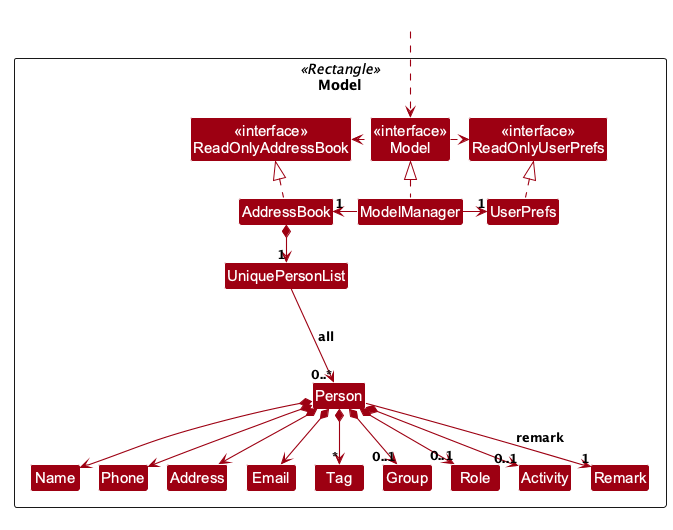
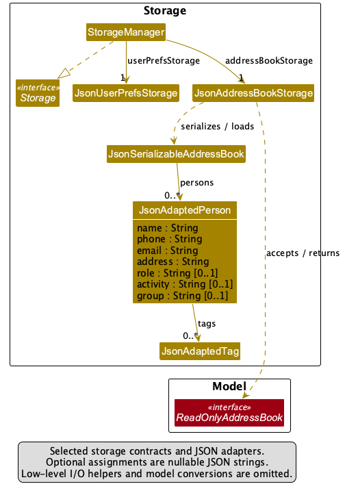
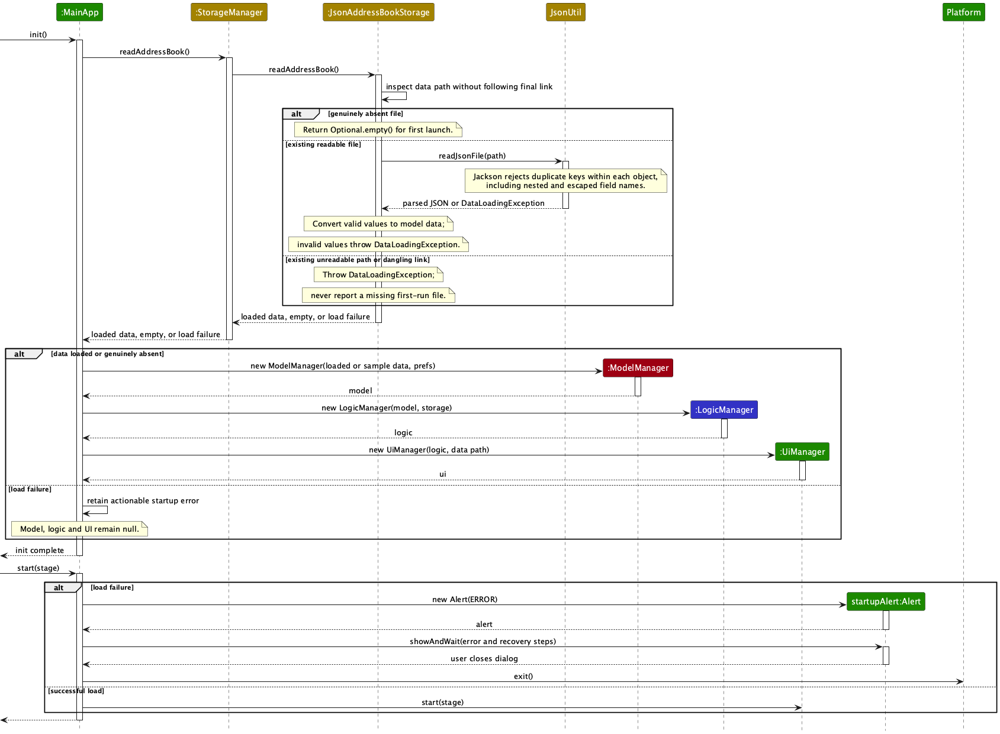
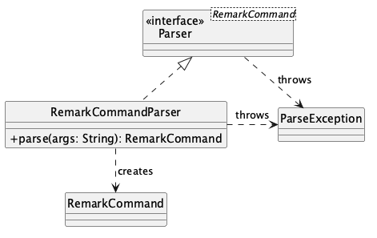
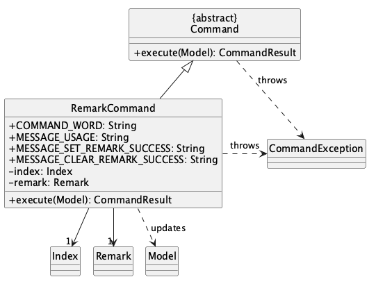
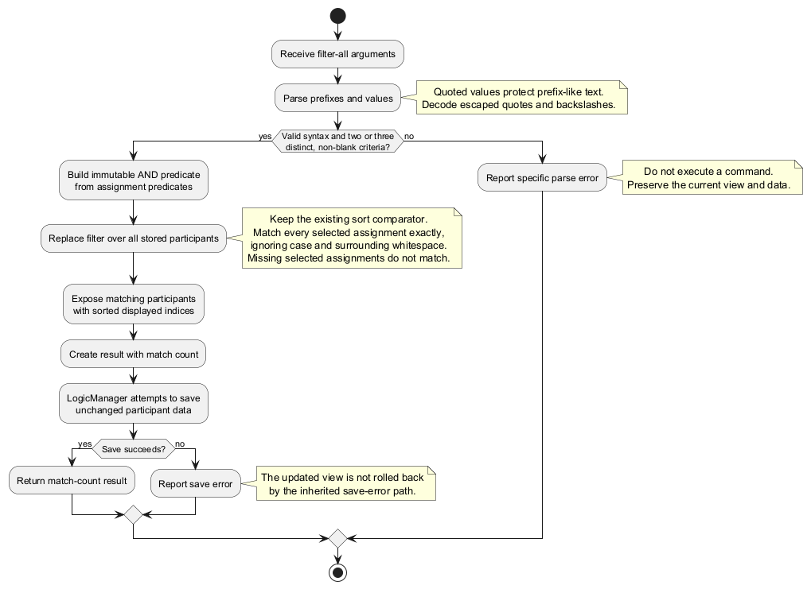
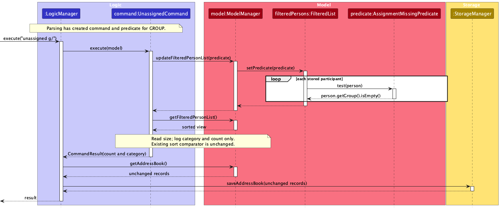

* Table of Contents
{:toc}

--------------------------------------------------------------------------------------------------------------------

## **Acknowledgements**

* ZoomAddress is based on
  [AddressBook-Level3](https://github.com/se-edu/addressbook-level3) by the
  [SE-EDU initiative](https://se-education.org/). Its architecture, build configuration,
  testing utilities, and parts of its documentation structure were adapted from that project.
* The desktop interface uses [JavaFX](https://openjfx.io/), and JSON persistence uses
  [Jackson](https://github.com/FasterXML/jackson).
* Automated tests use [JUnit 5](https://junit.org/junit5/), and diagrams are rendered with
  [PlantUML](https://plantuml.com/).

--------------------------------------------------------------------------------------------------------------------

## **Setting up, getting started**

Refer to the guide [_Setting up and getting started_](SettingUp.md).

--------------------------------------------------------------------------------------------------------------------

## **Design**

:bulb: **Tip:** The `.puml` files used to create diagrams are in `docs/diagrams`. Refer to the [_PlantUML Tutorial_ at se-edu/guides](https://se-education.org/guides/tutorials/plantUml.html) to learn how to create and edit diagrams.

### Architecture

The ***Architecture Diagram*** given above explains the high-level design of the App.

The following provides a quick overview of the main components and their interactions.

**Main components of the architecture**

**`Main`** (consisting of classes [`Main`](https://github.com/AY2627S1-CS2103T-W13-2/tp/blob/master/src/main/java/seedu/address/Main.java) and [`MainApp`](https://github.com/AY2627S1-CS2103T-W13-2/tp/blob/master/src/main/java/seedu/address/MainApp.java)) is in charge of the app launch and shut down.
* At app launch, it initializes the other components in the correct sequence, and connects them up with each other.
* At shut down, it shuts down the other components and invokes cleanup methods where necessary.

The bulk of the app's work is done by the following four components:

* [**`UI`**](#ui-component): The UI of the App.
* [**`Logic`**](#logic-component): The command executor.
* [**`Model`**](#model-component): Holds the data of the App in memory.
* [**`Storage`**](#storage-component): Reads data from, and writes data to, the hard disk.

[**`Commons`**](#common-classes) represents a collection of classes used by multiple other components.

**How the architecture components interact with each other**

The *Sequence Diagram* below shows how the components interact with each other for the scenario where the user issues the command `delete 1`.

Each of the four main components (also shown in the diagram above),

* defines its *API* in an `interface` with the same name as the Component.
* provides its functionality through a concrete `{Component Name}Manager` class that implements the corresponding API interface.

For example, the `Logic` component defines its API in `Logic.java` and implements it in `LogicManager.java`. Other components interact with a component through its interface rather than its concrete class, preventing them from coupling to that component's implementation, as illustrated in the following partial class diagram.

The sections below give more details of each component.

### UI component

The **API** of this component is specified in [`Ui.java`](https://github.com/AY2627S1-CS2103T-W13-2/tp/blob/master/src/main/java/seedu/address/ui/Ui.java)

The UI consists of a `MainWindow` and its parts, such as `CommandBox`, `ResultDisplay`, `PersonListPanel`, and `StatusBarFooter`. All of these, including `MainWindow`, inherit from the abstract `UiPart` class, which captures common behavior among classes that represent visible GUI parts.

The `UI` component uses the JavaFX UI framework. The layouts of these UI parts are defined in matching `.fxml` files in `src/main/resources/view`. For example, [`MainWindow.fxml`](https://github.com/AY2627S1-CS2103T-W13-2/tp/blob/master/src/main/resources/view/MainWindow.fxml) specifies the layout of [`MainWindow`](https://github.com/AY2627S1-CS2103T-W13-2/tp/blob/master/src/main/java/seedu/address/ui/MainWindow.java).

The `UI` component,

* executes user commands using the `Logic` component.
* listens for changes to `Model` data so that the UI can be updated with the modified data.
* keeps a reference to the `Logic` component, because the `UI` relies on the `Logic` to execute commands.
* depends on some classes in the `Model` component because it displays `Person` objects from the model.

### Logic component

**API** : [`Logic.java`](https://github.com/AY2627S1-CS2103T-W13-2/tp/blob/master/src/main/java/seedu/address/logic/Logic.java)

Here's a (partial) class diagram of the `Logic` component:

The sequence diagram below illustrates command execution, model lookup, and saving for `execute("delete 1")`.

The command resolves index `1` against the **currently displayed list**, then passes the selected `Person` to
`Model.deletePerson`. `LogicManager` saves after command execution; a save failure reports an error but does not
restore the in-memory deletion.

:information_source: **Note:** The lifeline for `DeleteCommandParser` should end at the destroy marker (X), but due to a limitation of PlantUML, it continues to the end of the diagram.

How the `Logic` component works:

1. When `Logic` is called upon to execute a command, the command is passed to an `AddressBookParser` object, which in turn creates a parser that matches the command (e.g., `DeleteCommandParser`) and uses it to parse the command.
1. This results in a `Command` object (more precisely, an object of one of its subclasses e.g., `DeleteCommand`) which is executed by the `LogicManager`.
1. The command can communicate with the `Model` when it is executed (e.g. to delete a person). 
   Note that although this is shown as a single step in the diagram above for simplicity, the code can require several interactions between the command object and the `Model` to complete the operation.
1. The result of the command execution is encapsulated as a `CommandResult` object which is returned from `Logic`.

Here are the other classes in `Logic` (omitted from the class diagram above) that are used for parsing a user command:

How the parsing works:
* When called upon to parse a user command, the `AddressBookParser` class creates an `XYZCommandParser` (`XYZ` is a placeholder for the specific command name, e.g., `AddCommandParser`). The parser uses the other classes shown above to parse the user command and create an `XYZCommand` object (e.g., `AddCommand`). The `AddressBookParser` returns that object as a `Command` object.
* For `list`, `clear`, `help`, and `exit`, `AddressBookParser` creates a `NoArgumentsCommandParser`. This parser
  accepts only empty or whitespace-only arguments, reports the command-specific usage message for extraneous input,
  and creates the corresponding command through its command factory.
* All `XYZCommandParser` classes, such as `AddCommandParser` and `DeleteCommandParser`, implement the `Parser` interface so they can be treated similarly where appropriate, for example during testing.
  `NoArgumentsCommandParser` implements the same interface, allowing `AddressBookParser` to use a consistent parsing
  contract for commands with and without arguments.

### Model component
**API** : [`Model.java`](https://github.com/AY2627S1-CS2103T-W13-2/tp/blob/master/src/main/java/seedu/address/model/Model.java)

This partial diagram includes the optional group, role, and activity value objects: a participant has **zero or one**
of each, not a separate collection of assignments.

The `Model` component,

* stores the address book data i.e., all `Person` objects (which are contained in a `UniquePersonList` object).
* derives the displayed participant list by applying a `FilteredList` and then a `SortedList` to the stored participant records. The UI observes this derived list, so filtering and sorting change the view without rearranging the records in `AddressBook`.
* stores a `UserPrefs` object that represents the user’s preferences (currently, just the GUI settings). This is exposed to the outside as a `ReadOnlyUserPrefs` object.
* does not depend on any of the other three components (as the `Model` represents data entities of the domain, they should make sense on their own without depending on other components)

### Storage component

**API** : [`Storage.java`](https://github.com/AY2627S1-CS2103T-W13-2/tp/blob/master/src/main/java/seedu/address/storage/Storage.java)

The `Storage` component,
* can save both address book data and user preference data in JSON format, and read them back into corresponding objects.
* is implemented by `StorageManager`, which delegates the actual JSON file access to `JsonAddressBookStorage` and `JsonUserPrefsStorage` (one class per data file).
* depends on some classes in the `Model` component (because the `Storage` component's job is to save/retrieve objects that belong to the `Model`)

The class diagram shows the stable storage contracts and JSON adapters rather than low-level I/O helpers.
`StorageManager` implements the `Storage` interface and holds one storage object for each file. Each serialized
participant contains its own nullable group, role, and activity strings and a list of tag adapters; there is no
separate persisted group, role, or activity directory. The `0..*` multiplicities allow an empty directory or no tags.

### Backward-compatible participant remarks

`Person` holds one non-null immutable `Remark`; `Remark.value` is free text and `""` means no note. Text is retained
exactly, including Unicode, whitespace, quotes and line breaks. Legacy `Person` constructors default to an empty
remark, while the full constructor accepts it after the optional group. `getRemark()` provides the value for
dependent command and UI increments. Remark changes affect `equals` and `hashCode`, but not name-based identity.
The partial model diagram focuses on stored participant values; the derived filtered/sorted view pipeline is
described in the Model component text rather than expanded in this diagram.

`JsonAdaptedPerson` stores `remark` as a JSON string. Its creator reads a `JsonNode` so Jackson cannot silently
coerce numbers or booleans to text. Missing or JSON `null` values become empty text; arrays, objects, numbers and
booleans are rejected with `Remark must be a JSON string or null.` through the existing `DataLoadingException`
path. Quoted strings such as `"42"` and `"true"` remain valid text. Saving emits the string, including `""`.
Existing files need no manual migration or deletion, and a read leaves their bytes unchanged.
All paths that replace a `Person` in edit, assign-group, assign-role, assign-activity and unassign carry the original
remark forward. The `remark` command described below is the only command that changes this value. Detail and card
rendering remain separate increments.

`RemarkStorageTest` covers legacy/null/empty input, rejection of non-text JSON without changing the file,
unchanged bytes on read and full-field disk round trips. It inspects each saved remark's JSON type and exact text,
including the explicit empty string, rather than relying only on equality after reloading.
`RemarkPreservationIntegrationTest` exercises edit, each assignment and each unassignment through parser, logic
and real storage using sorted/filtered displayed indices. It also checks invalid-index rejection without data loss.

### Participant data at startup

`MainApp` creates the editable model, logic and UI only after participant data loads. `JsonAddressBookStorage`
checks the data path without following the final symbolic link. A genuinely absent file produces `Optional.empty()`
and the existing sample-data first launch. An existing malformed file, invalid stored value, unreadable path or
dangling final symbolic link produces `DataLoadingException` instead. The extra existence check prevents
`JsonUtil`'s following-link `Files.exists` check from treating a dangling link as a missing first-run file.
`JsonUtil` also rejects a top-level JSON `null` as a load failure. The JSON adapters reject null person and tag
entries with `IllegalValueException`; storage translates that checked validation failure to `DataLoadingException`
without masking unrelated runtime errors during model conversion.

On a load failure, `MainApp` retains an actionable error containing the absolute data path and does not construct
`ModelManager`, `LogicManager` or `UiManager`. Its `start` method shows an error dialog, then exits when the user
closes it. The participant file is not modified, and `stop` skips preference saving when initialization did not
produce a model. This is a startup fail-safe, not automatic repair or backup recovery; the user must back up and
correct the input or restore a known-good copy before restarting.
Read failures log the file path and exception type, not the malformed JSON or participant values.

### Common classes

Classes used by multiple components are in the `seedu.address.commons` package.

--------------------------------------------------------------------------------------------------------------------

## **Implementation**

This section describes some noteworthy details on how certain features are implemented.

### Saving participant data safely

`JsonAddressBookStorage` constructs the complete `JsonSerializableAddressBook` snapshot and serializes it before
creating any destination or temporary file. It delegates only the write step to the package-private `AtomicFileWriter`;
the JSON schema, public read methods, and `DataLoadingException` contract are unchanged. In particular, read failures
are not converted into an empty address book by this save implementation.

Snapshot/serialization runtime failures and checked serialization errors are wrapped as `IOException`, preserving
the original cause and using a participant-free error message. This allows the existing Logic save-error handler
to produce `CommandException` even when snapshot construction fails. Null method arguments still fail the explicit
precondition checks outside this boundary; JVM errors are not caught.

The writer follows these steps:

1. Resolve an existing final symbolic link to its target, reject a directory destination, and prepare the parent folder.
2. Create a uniquely named sibling `.tmp` file, write the complete UTF-8 content, and flush its file channel.
3. If a participant file already exists, copy its bytes to a uniquely named sibling `.bak` file. An incomplete backup
   is never used for recovery. Failure before replacement leaves the destination untouched.
4. Replace the destination using `Files.move` with `ATOMIC_MOVE`. No non-atomic or direct-write fallback is used.
   Some filesystems cannot atomically replace an existing file; the save then fails rather than weakening the guarantee.
5. On a replacement I/O failure, attempt an atomic restore from the completed backup. If restoration fails, retain
   that backup and include its path in the thrown `IOException`. Unsupported atomic moves do not attempt a fallback.
   Remove disposable files where possible, preserving the main exception and any cleanup errors. Cleanup failure
   after a committed save is logged rather than incorrectly reporting that save as failed.

`FileOperations` is an injectable filesystem boundary used by deterministic tests for partial writes, backup failures,
replacement errors before and after a completed move, unsupported moves, restoration failures, cleanup, and retries.
Tests also check first saves, byte preservation, complete assignment round trips, and the existing Logic error path.
Save diagnostics log operation phases and recovery-file locations, without participant values or raw exception text.

`LogicManager` still executes the command before attempting a save and converts write errors to `CommandException`.
This change therefore does not roll back the in-memory model. The writer assumes one writer and does not provide
power-loss durability, cross-process coordination, automatic startup recovery, or new guarantees for preferences.
Retained backups are deliberately not overwritten or automatically consumed by subsequent saves.

### Clearing a participant assignment

The `unassign` command accepts a displayed participant index and exactly one empty `g/`, `r/`, or `a/` prefix.
`UnassignCommandParser` validates the syntax and maps the prefix to `AssignmentType`, which keeps the three
assignment categories in one place. `UnassignCommand` looks up the participant in the currently displayed list,
checks that the selected assignment exists, and creates an updated `Person` with only that optional field empty.
It replaces the participant through `Model.setPerson`; `LogicManager` then saves the model to disk. Invalid input
or a missing assignment produces an error without modifying the participant.

### Preserving the displayed view after an edit

`EditCommand` resolves its index against `Model.getFilteredPersonList()`, which is the current filtered and sorted
view. After replacing the selected participant through `Model.setPerson`, it leaves the existing filter predicate
and sort comparator unchanged. The `FilteredList` immediately re-evaluates the edited participant: an edit to an
unrelated field keeps the participant in the filtered view, while an edit that no longer matches the query removes
that participant. The `SortedList` repositions a participant if the edited value affects its comparator. Both cases
update the displayed indices. `EditCommandTest` covers consecutive edits in a group-filtered view and the index
transition when a name edit changes search membership.

### Updating a participant remark

The `remark INDEX r/TEXT` command sets or replaces the selected participant's remark; an empty `r/` clears it.
`AddressBookParser` delegates to `RemarkCommandParser`, which tokenizes the single `r/` prefix, rejects duplicate or
missing prefixes, and parses the positive displayed index. The shared tokenizer recognizes prefixes only when they
are preceded by an ASCII space. Consequently, a second ASCII-space-delimited `r/` is rejected, while an `r/`
preceded by a tab or another Unicode whitespace character remains part of the remark text. The parser strips
surrounding Unicode whitespace from the remark text after tokenization. Empty text is deliberately valid because it
represents a clear operation.

The following class diagram shows the parser's contract and its creation of a `RemarkCommand`:

The parsed command owns one displayed `Index` and one immutable `Remark`. During execution, it uses the `Model` API
to replace only the selected participant:

`RemarkCommand` resolves the index against `Model.getFilteredPersonList()`, so the command uses the exact indices
shown after filtering and sorting. It constructs a replacement `Person` with the new `Remark` and every other field
copied from the selected participant, then calls `Model.setPerson`. It deliberately does not call
`updateFilteredPersonList` or `updateSortedPersonList`; the user's current view and ordering therefore remain active.
An out-of-range displayed index fails before replacement, leaving the model unchanged. After successful execution,
the existing `LogicManager` save path persists the new remark.

`RemarkCommandTest` covers adding, replacing and clearing remarks, full-field preservation, filtered/sorted indices,
view preservation and invalid indices. `RemarkCommandParserTest` covers empty remarks, missing and malformed indices,
missing and duplicate prefixes, punctuation, Unicode whitespace stripping, and ASCII-space versus Unicode-space
prefix boundaries. `RemarkCommandIntegrationTest` routes the real command through logic and JSON storage, then
reloads after add, replace and clear operations.

### Sorting participants by name

The `sort name` command changes the order of the currently displayed participants without
changing the order of records stored in `AddressBook`.

The diagram omits parser construction to keep the view-update and subsequent save path readable. Although sorting
only changes a `SortedList` comparator, `LogicManager` still invokes the normal address-book save path before
returning the result; the comparator itself is not serialized.

1. `AddressBookParser` delegates the argument to `SortCommandParser`, which accepts exactly
   the `name` criterion and creates a `SortCommand`.
2. `SortCommand` asks the `Model` to apply its single name comparator. The comparator compares
   names case-insensitively first, then compares the exact name text to produce a deterministic
   order when the primary comparison is equal.
3. `ModelManager` applies the comparator to a JavaFX `SortedList` layered over the existing
   `FilteredList`. Consequently, an active filter still determines which participants are
   relevant, while sorting determines only their displayed order.
4. Commands that consume displayed indices continue to read the same derived observable list,
   so index `1` refers to the first participant in the sorted view.

The comparator is view state and is not written to JSON. A newly started application therefore
uses the stored participant order until the user enters `sort name` again. This choice avoids a
data mutation for a display-only operation and keeps persistence focused on participant records.

### Contact-based participant search

The `find-contact` command locates participants using one complete phone number or email address without modifying
the address book.

1. `AddressBookParser` routes the command arguments to `FindContactCommandParser`.
1. `FindContactCommandParser` calls `String.strip()` to remove surrounding whitespace recognized by
   `Character.isWhitespace`, including EM SPACE and IDEOGRAPHIC SPACE. It then validates the exact remaining value
   using the existing `Phone` and `Email` rules. It does not remove internal whitespace, non-breaking spaces or
   zero-width formatting characters. Blank, malformed, or multiple values are rejected before command execution.
1. The parser creates a `ContactMatchesQueryPredicate` and places it in a `FindContactCommand`.
1. When executed, the command passes the predicate to `Model#updateFilteredPersonList`. Phone numbers require an
   exact match, while email addresses require an exact case-insensitive match.
1. The observable filtered list changes, so the UI displays the matching participants while the underlying data
   remains unchanged.

The predicate is kept in the Model package because it evaluates `Person` contact fields and can be tested
independently of command parsing and execution. Reusing the existing validators also keeps accepted search values
consistent with values that can be stored for a participant.

`FindContactCommandParserTest` checks Unicode padding, blank input and rejected internal/non-breaking/zero-width
characters. `FindContactWorkflowIntegrationTest` exercises full command routing from a sorted/filtered view,
case-insensitive email and exact phone searches, displayed indices, no-match and invalid input. It verifies that
participant fields (including assignments and remarks), saved JSON bytes and reloaded records stay unchanged.

### Assignment filtering

`FilterCommandParser` accepts exactly one of the group, role, or activity prefixes and creates one `FilterCommand`.
The command uses the reusable `AssignmentMatchesPredicate`, parameterised by an `AssignmentType`, instead of separate
predicates and commands for each assignment field. The predicate trims the requested value, normalises it with
locale-independent lower-casing, and compares it with the participant's corresponding optional assignment. A missing
assignment therefore cannot match.

For a quoted single-filter value, `FilterCommandParser` uses the same `QuotedAssignmentValueParser` as
`FilterAllCommandParser`. The shared parser decodes only escaped quotes and backslashes and treats prefix-like text
inside the quotes as literal value text. A closing quote must be followed by whitespace or end of input, and any
non-whitespace remainder is rejected by the single-filter parser. Quoting errors are `ParseException`s, so the
command does not execute and the current displayed list stays unchanged. The unquoted single-filter path still
checks the complete value against stored assignments before interpreting a later supported prefix as a conflicting
criterion; this retains searches such as `filter g/team a/b` for a stored group named `Team A/B`.
Only a leading quote enters the new quoted-value path; an unquoted label such as `Team "A"` remains a literal search
value for backward compatibility. In contrast, `filter-all` continues to reject partial quotes in unquoted values.
The leading quote is necessarily syntax in the new grammar, so an older query `filter g/"Alpha"` now matches the
unquoted label `Alpha` rather than a stored label containing those quote characters. To find the latter, escape the
literal quotes inside a quoted query: `filter g/"\"Alpha\""`. Tests cover both labels in one address book so the
distinction cannot silently regress.

Executing the command updates only the model's `FilteredList`. It does not replace or reorder the `AddressBook`'s
stored participant list. The UI observes the filtered list and assigns fresh displayed indices to the matching records.

### Combined assignment filtering

`AddressBookParser` routes `filter-all` to `FilterAllCommandParser`. The parser walks the input from left to right,
collecting an `EnumMap<AssignmentType, String>`. It requires two or three distinct supported categories and rejects
blank values. Unquoted values end at the next whitespace-delimited letters-plus-slash prefix; unsupported prefixes
are rejected rather than silently absorbed. Embedded slashes within a token remain literal. Entire quoted values
protect prefix-like text and decode only escaped double quotes/backslashes. Unterminated quotes, invalid escapes,
partial quoting and missing separators are parse errors before any model update.

The parser constructs `AssignmentsMatchAllPredicate`, which defensively validates and copies the criteria and
composes the existing `AssignmentMatchesPredicate` instances with `allMatch` (AND). This keeps matching in Model
and shares exact, locale-independent case-insensitive matching and absent-assignment semantics with `filter`.
Criterion order is immaterial. `FilterCommand` and the assignment matching predicate retain their existing
case-insensitive, slash-containing-label behavior; only the quoted-value parsing path is shared with `filter`.

`FilterAllCommand` replaces the model's filter predicate over all stored participants. It never filters an already
filtered snapshot, changes the sorted-view comparator, or mutates participant records. Index-based commands read
the same derived sorted view. The inherited `LogicManager` path still saves after a successful query; this feature
promises unchanged data and order, not a no-write path or rollback on save failure. No JSON/schema changes are made.

Tests exercise all criterion pairs and triples, AND versus OR, missing assignments, full-list queries after an empty
filter, sorted indices, quote/escape boundaries, and byte-for-byte JSON preservation through real save/reload.

### Finding incomplete allocations

`unassigned` accepts exactly one empty `g/`, `r/`, or `a/` prefix. `AddressBookParser` delegates to
`UnassignedCommandParser`, which validates the complete argument before creating a command. Missing, unsupported,
repeated or multiple prefixes, non-empty values and stray text produce distinct parse errors without execution.

`UnassignedCommand` uses `AssignmentMissingPredicate` in the Model package. It reuses the assignment-category enum
from `AssignmentMatchesPredicate`, keeping the new predicate independent of Logic-layer types. The predicate checks
whether the selected `Optional` is empty, not whether its label equals a display placeholder. A participant can
therefore match a missing-group query while still having a role and activity.

The sequence below focuses on command execution after parsing has created `command` and `predicate`.

1. `LogicManager` executes the parsed `UnassignedCommand` against the current model.
1. The command replaces the `FilteredList` predicate through `Model.updateFilteredPersonList`. Because that list is
   backed by all stored participants, previous searches do not restrict the new query.
1. The existing `SortedList` comparator remains active. Index-based commands read this same derived view.
1. The command returns the match count and category. Its diagnostic log records only those two values, not records
   or assignment labels.
1. The existing `LogicManager` successful-command path saves the unchanged address book. The query does not skip
   that save or guarantee that the file is never rewritten; its guarantee is unchanged participant fields/order.
   The query predicate and sort comparator are session-only view state, not additional JSON fields.

Tests cover each category independently, prior empty filters, sort/view indices, zero/all matches, rejected syntax,
and byte-for-byte JSON content plus participant-field preservation through the real save/reload path. No storage
schema or assignment cardinality changes are required.

### Unsupported undo and redo

ZoomAddress does not implement `undo` or `redo`, and it does not keep a `VersionedAddressBook` history.
The inherited AddressBook-Level3 undo/redo diagrams are intentionally omitted because they do not describe
the released application. Back up participant data before destructive commands such as `delete` and `clear`.

### Future data archiving (not implemented)

ZoomAddress does not implement data archiving. The feature remains outside the current
product scope and is mentioned only as a possible future enhancement.

--------------------------------------------------------------------------------------------------------------------

## **Documentation, logging, testing, dev-ops**

* [Documentation guide](Documentation.md)
* [Testing guide](Testing.md)
* [Logging guide](Logging.md)
* [DevOps guide](DevOps.md)

--------------------------------------------------------------------------------------------------------------------

## **Appendix: Requirements**

### Product scope

**Target user profile**:

* is a director coordinating a large-scale computing event, such as an orientation camp
* repeatedly records, retrieves, and corrects participant information
* needs to track how participants are assigned to groups, roles, and activities
* prefers fast, keyboard-driven workflows
* needs participant data to remain available locally without relying on a remote service

**Value proposition**: ZoomAddress helps computing event directors keep track of participants and their relevant
information, making it easier to coordinate people across different groups, roles, and activities during large-scale
computing events.

ZoomAddress covers a local participant directory and participant-to-group, participant-to-role, and
participant-to-activity assignments. It does not cover registration collection, messaging, payments, a full event
timetable, simultaneous multi-user editing, or remote hosting.

### User stories

Priorities: High (must have) - `* * *`, Medium (nice to have) - `* *`, Low (unlikely to have) - `*`

These stories record both implemented needs and possible future work. A priority is **not** an implementation-status
claim. The [User Guide](UserGuide.md) is the source of truth for commands available in the current release;
multiple roles, attendance, import/export, undo, and backup commands are not implemented.

| ID | Priority | As a …​ | I want to …​ | So that I can …​ |
| -- | -------- | ------- | ------------ | ---------------- |
| ZA-01 | `* * *` | event director | add a participant | record someone involved in the event |
| ZA-02 | `* * *` | event director | view all participants | see whom I am coordinating |
| ZA-03 | `* * *` | event director | view one participant's full record | understand that participant's relevant details |
| ZA-04 | `* * *` | busy event director | find participants by name | retrieve a record quickly |
| ZA-05 | `* *` | event director | find a participant by contact information | identify a person when the name is uncertain |
| ZA-06 | `* *` | event director | edit a participant's details | correct or update information |
| ZA-07 | `* * *` | event director | delete a participant | remove withdrawn or mistakenly entered people |
| ZA-08 | `*` | new user | see sample participant data | understand the information ZoomAddress manages |
| ZA-09 | `*` | user ready to enter real data | clear all sample data | begin with a clean directory |
| ZA-10 | `* *` | event director | be warned about a possible duplicate | avoid conflicting participant records |
| ZA-11 | `* *` | event director | record the groups used by the event | use meaningful assignment groupings |
| ZA-12 | `* * *` | event director | assign a participant to a group | know which group is responsible for them |
| ZA-13 | `* *` | event director | move a participant to another group | keep late allocation changes accurate |
| ZA-14 | `* *` | event director | list the participants in a group | coordinate that group as a unit |
| ZA-15 | `* *` | event director | list participants without a group | finish incomplete allocations |
| ZA-16 | `* *` | event director | record the roles used by the event | use consistent responsibility labels |
| ZA-17 | `* * *` | event director | assign a role to a participant | know what the participant is responsible for |
| ZA-18 | `* *` | event director | assign more than one role to a participant | represent overlapping responsibilities |
| ZA-19 | `* *` | event director | list participants with a specified role | find the people responsible for a task |
| ZA-20 | `* *` | event director | record the activities in an event | use consistent activity names |
| ZA-21 | `* * *` | event director | assign a participant to an activity | know who is expected to take part |
| ZA-22 | `* *` | event director | remove a participant from an activity | keep withdrawals and changes accurate |
| ZA-23 | `* *` | event director | list participants assigned to an activity | prepare and coordinate that activity |
| ZA-24 | `* *` | event director | list participants without any activity | identify incomplete allocations |
| ZA-25 | `* *` | busy event director | filter by group, role, and activity together | answer operational questions quickly |
| ZA-26 | `* *` | event director | sort participant records by name | scan a large directory predictably |
| ZA-27 | `*` | event director | add a short note to a participant | retain context not covered by standard fields |
| ZA-28 | `*` | event director | mark a participant's attendance | see who has arrived |
| ZA-29 | `*` | event director | list participants whose attendance is unconfirmed | follow up on missing people |
| ZA-30 | `*` | event director | record authorised dietary or accessibility needs | support participants appropriately |
| ZA-31 | `*` | event director | record an authorised emergency contact | respond appropriately during an incident |
| ZA-32 | `*` | event director migrating from a spreadsheet | import participant records in bulk | avoid re-entering every participant |
| ZA-33 | `*` | event director | export an authorised participant list | use it in permitted offline workflows |
| ZA-34 | `*` | event director who made a mistake | undo my latest data-changing action | recover quickly |
| ZA-35 | `* * *` | event director | retain data between sessions | avoid losing records when the app closes |
| ZA-36 | `* * *` | privacy-conscious event director | avoid sending data to a remote server | keep participant records local |
| ZA-37 | `*` | event director | create a local backup | recover from device or file failure |
| ZA-38 | `* *` | first-time user | access concise usage help | perform essential operations independently |
| ZA-39 | `* * *` | experienced user | perform common operations by typing | update records quickly during a busy event |
| ZA-40 | `* *` | event director | see a clear confirmation after a change | know whether records were updated |

### Use cases

#### UC01: Add a participant

* **System:** ZoomAddress
* **Use-case name:** Add a participant
* **Actor:** Event director
* **Preconditions:** The event director has the participant's authorised details.
* **Guarantees:** A successful command adds and saves one participant. Invalid input or a duplicate leaves the model
  unchanged. A disk-save failure is reported, but the in-memory model is **not** rolled back.

**Main Success Scenario**

1. **Actor:** Enters `add` with the required name, phone, email, and address, and any tags.
2. **System:** Validates the command and checks for a duplicate participant.
3. **System:** Adds the participant to the model and saves the address book.
4. **System:** Confirms that the participant was added.

    Use case ends.

**Extensions**

* 2a. Required information is missing or invalid.
    * 2a1. **System:** Reports the relevant format or value constraint. The actor may enter a corrected command.

    Use case ends.

* 2b. The details match an existing participant.
    * 2b1. **System:** Reports the duplicate without adding a record.

    Use case ends.

* 3a. Saving fails.
    * 3a1. **System:** Reports the save failure instead of confirming success. The in-memory addition may still be
      visible; the user must resolve the storage problem before relying on persistence.

    Use case ends.

#### UC02: Update a participant's details

* **System:** ZoomAddress
* **Use-case name:** Update a participant's details
* **Actor:** Event director
* **Preconditions:** The participant has an existing record.
* **Guarantees:** A successful command updates and saves one participant. Invalid input or a duplicate leaves the
  model unchanged. A disk-save failure is reported but does not undo an in-memory edit.

**Main Success Scenario**

1. **Actor:** Finds or lists participants and notes the displayed index.
2. **System:** Displays the matching participants.
3. **Actor:** Enters `edit` with that index and at least one revised field.
4. **System:** Validates the displayed index and revised fields, and checks for a duplicate participant.
5. **System:** Replaces the participant in the model and saves the address book.
6. **System:** Confirms the edit.

    Use case ends.

**Extensions**

* 2a. No participant matches the identifying information.
    * 2a1. **System:** Reports that no participant was found.

    Use case ends.

* 4a. Some revised details are invalid.
    * 4a1. **System:** Identifies the invalid details and explains the applicable constraint.
    * 4a2. Use case resumes at step 3.
* 4b. The revised details definitely match another participant.
    * 4b1. **System:** Reports the conflict and does not update the record.
    * 4b2. Use case resumes at step 3.
* 4c. The index is outside the currently displayed list.
    * 4c1. **System:** Reports the invalid displayed index without changing the participant.

    Use case ends.

* 5a. Saving fails.
    * 5a1. **System:** Reports the save failure. The in-memory edit may remain even though persistence is unconfirmed.

    Use case ends.

#### UC03: Assign a participant to a group, role, or activity

* **System:** ZoomAddress
* **Use-case name:** Assign a participant to a group, role, or activity
* **Actor:** Event director
* **Preconditions:** The participant is in the directory.
* **Guarantees:** A successful command replaces one selected assignment and saves the record, preserving the other
  fields. A save failure is reported but does not roll back an in-memory change.

**Main Success Scenario**

1. **Actor:** Requests participants matching identifying information.
2. **System:** Provides the matching participant records.
3. **Actor:** Enters `assign-group`, `assign-role`, or `assign-activity` with the displayed index and one label.
4. **System:** Validates the index and non-blank label.
5. **System:** Replaces that category's assignment, if any, and saves the address book.
6. **System:** Confirms the assignment.

    Use case ends.

**Extensions**

* 2a. No participant matches the identifying information.
    * 2a1. **System:** Reports that no participant was found.

    Use case ends.

* 4a. The index is out of range or the label is invalid.
    * 4a1. **System:** Reports the error without changing the participant.

    Use case ends.

* 5a. Saving fails.
    * 5a1. **System:** Reports the failure. The new assignment may still be present in memory.

    Use case ends.

There is no separate group/role/activity catalogue or replacement-confirmation step. Each participant has at most
one value in each category; issuing another assignment command replaces the previous value in that category.

#### UC04: Find participants by event assignment

* **System:** ZoomAddress
* **Use-case name:** Find participants by event assignment
* **Actor:** Event director
* **Preconditions:** Participant records and their event assignments have been stored.
* **Guarantees:** Participant records and assignments remain unchanged.

**Main Success Scenario**

1. **Actor:** Specifies one or more group, role, or activity criteria.
2. **System:** Validates the criteria.
3. **System:** Finds participants who satisfy all the specified criteria.
4. **System:** Provides the matching participants.
5. **Actor:** Requests the full record of a matching participant.
6. **System:** Provides the participant's full record and assignments.

    Use case ends.

**Extensions**

* 2a. The command has invalid syntax, such as a missing, blank, or repeated prefix.
    * 2a1. **System:** Reports the syntax error.
    * 2a2. Use case resumes at step 1.
* 3a. No participant has the specified assignment values (including a valid but unknown label).
    * 3a1. **System:** Successfully completes the query, reports zero matches, and displays an empty result list.
      Participant records remain unchanged.

    Use case ends.

#### UC05: Delete a participant

* **System:** ZoomAddress
* **Use-case name:** Delete a participant
* **Actor:** Event director
* **Preconditions:** The participant has an existing record.
* **Guarantees:** A successful command removes and saves the participant record. An invalid index leaves the model
  unchanged. A disk-save failure is reported but does not restore a participant already removed from memory.

**Main Success Scenario**

1. **Actor:** Requests participants matching identifying information.
2. **System:** Provides the matching participant records.
3. **Actor:** Enters `delete` with the participant's currently displayed index.
4. **System:** Validates the index, removes the selected participant, and attempts to save the address book.
5. **System:** Confirms the deletion if saving succeeds.

    Use case ends.

**Extensions**

* 2a. No participant matches the identifying information.
    * 2a1. **System:** Reports that no participant was found.

    Use case ends.

* 4a. The index is outside the currently displayed list.
    * 4a1. **System:** Reports the invalid displayed index without removing a participant.

    Use case ends.

* 4b. Saving fails.
    * 4b1. **System:** Reports the save failure. The participant may still be absent from the in-memory list.

    Use case ends.

`delete` does not ask for confirmation and there is no undo command. The actor should check the displayed index
before entering it.

### Non-Functional Requirements

These are acceptance targets for ZoomAddress, not claims that every target has already been verified.
Unless stated otherwise, checks use one running instance, a writable local data folder, and at most 1,000
participant records, each with at most one group, one role, and one activity assignment.

1. **Usability - keyboard operation:** After launch, an event director must be able to enter and submit every
   participant-management command documented in the User Guide using only the keyboard, without clicking a control.
2. **Usability - learnability:** In a trial with five first-time users who are familiar with typing commands,
   at least four must be able to add a participant, find that participant, and correct one detail within 10 minutes,
   using only the User Guide and the application's feedback, without help from another person.
3. **Performance - response time:** On a computer with at least two CPU cores, 8 GB of RAM, an SSD, and Java 25,
   at least 95 of 100 consecutive valid local participant-management commands must display their result within
   two seconds of submission. The trial must include adding, listing, finding, editing, deleting, and changing
   assignments, with no other resource-intensive applications running.
4. **Portability:** The release's x64 JAR must launch and pass the add, list, find, edit, delete, and save/reopen
   smoke checks on Windows 11 x64, Ubuntu 24.04 LTS x64, and macOS 14 x64 with Java 25. The separate
   macOS arm64 JAR must pass the same checks on Apple Silicon with native arm64 Java 25. Neither check may
   require changing the source code or rebuilding the tested JAR. These are targets, not a claim that every
   platform has already been tested.
5. **Reliability - persistence:** After each of 20 valid data-changing commands that completes without a save
   error, closing the application normally and reopening it must restore all participant fields and assignments
   exactly as they were before closing. This target excludes forced termination and hardware failure.
6. **Reliability - invalid input:** For each documented command, missing required arguments, invalid field
   values, and out-of-range participant indices, where applicable, must produce an error without terminating the
   application or changing stored participant data. A subsequent valid command must still execute successfully.
7. **Availability - offline use:** After installation, the documented local participant-management commands
   must produce the same results with all network connections disabled as with them enabled, using the same data
   and command sequence. Opening external documentation links is excluded.
8. **Security - data disclosure:** ZoomAddress must not transmit participant records, contact details, or
   assignment data over the network during launch, local participant-management commands, or shutdown.
   A network trace of these operations must contain no application-originated transmission of this data.

### Glossary

* **Activity**: A named part of a computing event to which participants can be assigned; it is not a full timetable entry.
* **Assignment**: A recorded association between a participant and a group, role, or activity.
* **Computing event**: An organised event for a computing community, such as an orientation camp, whose participants
  are coordinated using ZoomAddress.
* **Event director**: The intended operator of ZoomAddress who maintains participant information and coordinates
  assignments for a computing event.
* **Group**: A named collection used to organise participants within an event, such as an orientation group.
* **Participant**: A person involved in a computing event whose details are kept in ZoomAddress, including attendees
  and people with event responsibilities.
* **Participant record**: The stored details and assignments for one participant; represented by `Person` in the
  existing codebase and referred to as a person or contact in inherited documentation.
* **Remark**: Free-text note stored with a participant record. An empty string represents no note; it is distinct
  from the participant's tags and event assignments.
* **Role**: An event responsibility assigned to a participant. In the requirements, this means an event role,
  not a software development team role or an application access permission.
* **Unassigned participant**: A participant with no assignment in the category being queried; for example, no group
  or no activity. Being unassigned in one category does not imply being unassigned in the others.

--------------------------------------------------------------------------------------------------------------------

## **Appendix: Instructions for Manual Testing**

These instructions describe reproducible smoke and exploratory tests for the release JAR. Perform them in a
temporary folder so that the test data does not replace a real `data/addressbook.json` file.

### Packaging JavaFX for macOS architectures

JavaFX 17.0.7 publishes separate `mac` (Intel x86-64) and `mac-aarch64`
(Apple Silicon arm64) artifacts. Their native libraries have the same resource
names, so merging both into one fat JAR can silently retain the wrong CPU binary.
The build includes Windows/Linux x64 libraries and exactly one macOS classifier.
All required JavaFX modules are explicit, with host-selected transitive classifiers disabled.

* `./gradlew clean shadowJar verifyMacNatives -PjavafxMacPlatform=mac` produces
  `build/libs/addressbook.jar` for Windows/Linux x64 and macOS with x64 Java
  (including Apple Silicon via Rosetta).
* `./gradlew clean shadowJar verifyMacNatives -PjavafxMacPlatform=mac-aarch64` produces
  `build/libs/addressbook-mac-aarch64.jar` for native Apple Silicon Java.
* Without an override, a native arm64 macOS JVM selects `mac-aarch64`; other build
  hosts select `mac`. Only these two values are accepted. Build tests on the host's
  matching classifier; cross-building a JAR does not prove it starts on the target OS.
* `verifyMacNatives`, also run by `check`, always opens the newly built JAR. It
  requires all seven macOS libraries and all Windows/Linux native resources from
  the selected dependencies, rejects missing/duplicate/unexpected entries, checks
  Mach-O headers and CPU types, and compares complete payload SHA-256 digests with
  the dependency JARs. This detects shading damage; it is not an independent audit
  of upstream binaries or proof of native startup.
* `testNativeVerifier`, also run by `check`, tests valid payloads and rejects missing,
  truncated, corrupted, duplicate, unexpected and wrong-architecture fixtures.
  CI runs these cases for both classifiers.
* To inspect an existing artifact separately, run
  `./gradlew verifyExternalMacNatives -PjavafxMacPlatform=mac-aarch64 -PjavafxVerificationJar=/path/to/candidate.jar`
  (use `mac` for the x64 variant). Passing `javafxVerificationJar` to the normal
  build verifier fails explicitly, so an external file cannot substitute for its output.
* CI checks both package variants, and runs host tests using a plain JDK so a bundled
  JavaFX SDK cannot hide missing dependencies. Native Apple Silicon startup must still
  be tested on a Mac with a fresh writable `-Djavafx.cachedir=...` directory.

Copy each build output before running the next `clean`. The v1.4.1 release copies are named
`ZoomAddress-v1.4.1.jar` and `ZoomAddress-v1.4.1-mac-aarch64.jar`; record each SHA-256
and the exact commit independently. These are distinct artifacts: test each on its
supported platform and audit the User Guide against the exact packaged JARs. A
checksum or approval for one artifact does not establish the identity or behavior
of a rebuilt artifact.

The published [v1.4.1 release](https://github.com/AY2627S1-CS2103T-W13-2/tp/releases/tag/v1.4.1)
uses commit `8bd9682b5c51bb80f6a6038924238ba443e2f17b`; its two JARs, checksums,
source archives and screenshots are release assets. For a future release, align
`MainApp.VERSION`, the tag, asset names and both guides before building. Verify that
the tag and GitHub-generated source archives identify the build commit, then
download and hash the public JARs, check screenshot and guide links, and record the
tested platforms and limitations. Never move a published tag or replace a tested JAR
silently; any rebuilt JAR needs new checksums and relevant retesting.

### Launching the JAR

1. Copy the JAR matching your Java runtime architecture into an empty folder.
   For the manual scenarios below, name this local test copy `addressbook.jar`.
   Use the Apple Silicon package for native arm64 Java on macOS; use the standard
   package for Windows/Linux x64 and macOS with x64 Java (including Apple Silicon
   via Rosetta). Check `os.arch` using `java -XshowSettings:properties -version`:
   `amd64`/`x86_64` is x64; `aarch64`/`arm64` is arm64. Published filenames are in the User Guide.
1. Open a terminal in that folder and run `java -jar addressbook.jar`.

Expected output: the ZoomAddress window opens and shows the sample participants. No error dialog appears.

Expected participant-data change: none until a command is run. Startup can create or update
`preferences.json` even without a participant command. ZoomAddress stores participant data at
`data/addressbook.json`, relative to the folder from which the JAR was launched.

To test window preferences, resize and move the window, exit, and run `java -jar addressbook.jar` again. The window
should reopen at the saved size and position; participant data should be unchanged.

### Preparing realistic participant data

Run the following commands in order. Each successful `add` command should report the participant that was added and
append exactly one participant to the displayed list.

1. `clear`
1. `add n/Alice Tan p/81234567 e/alice@example.com a/COM 1, 13 Computing Drive t/freshman`
1. `add n/Beth Lee p/82345678 e/beth@example.com a/COM 2, 15 Computing Drive t/facilitator`
1. `add n/Chen Wei p/83456789 e/chen@example.com a/COM 3, 11 Computing Drive`
1. `add n/dana Lim p/84567890 e/dana@example.com a/COM 1, 13 Computing Drive`

Precondition: the application is running and accepts commands.

Expected output: `clear` reports that all entries were cleared. Each `add` reports `New participant added:` followed
by that participant's details. The final list contains exactly four participants.

Expected data change: the previous participant data is removed and the four records above are saved.

### Core participant operations

| Preconditions | Command or action | Expected output | Expected data change |
|---|---|---|---|
| Prepared data is loaded. | `view 2` | Details for Beth Lee, including `Unassigned` for group, role, and activity. | None. |
| Prepared data is loaded. | `find bEtH` | One indexed result, Beth Lee; matching is case-insensitive. | None. |
| The Beth Lee search result is displayed. | `assign-group 1 g/Logistics` | Confirms that Beth Lee was assigned to Logistics. | Beth's group becomes Logistics; other fields remain unchanged. |
| Run `find Beth` again. | `assign-role 1 r/Facilitator` | Confirms that Beth Lee received the Facilitator role. | Beth's role becomes Facilitator; group and other fields remain unchanged. |
| Run `find Beth` again. | `assign-activity 1 a/Campfire` | Confirms that Beth Lee received the Campfire activity. | Beth's activity becomes Campfire; group, role, and other fields remain unchanged. |
| Run `find Beth` again. | `edit 1 p/87654321` | Reports the edited Beth Lee record. | Only Beth's phone changes; all three assignments remain. |
| Run `find Beth` again. | `view 1` | Shows phone `87654321`, group Logistics, role Facilitator, and activity Campfire. | None. |

### Assignment, sorting, and query workflows

#### Participant remarks

Use the prepared data and complete Beth's group, role, activity and phone updates from the core-operation table.

| Preconditions | Command or action | Expected output | Expected data change |
|---|---|---|---|
| Run `list`, then `sort name`. | `remark 2 r/Bring hearing loop; use entrance A/B.` | `Updated remark for Beth Lee.` The sorted list remains displayed. | Only Beth's remark changes. |
| The sorted list remains displayed. | `view 2` | Ends with `Remark: "Bring hearing loop; use entrance A/B."`. | None. |
| Run `find Beth`. | `remark 1 r/Wheelchair access confirmed.` | `Updated remark for Beth Lee.` The one-result view remains displayed. | Beth's remark is replaced; all other fields remain unchanged. |
| Exit, restart, and run `find Beth`. | `view 1` | Shows `Remark: "Wheelchair access confirmed."`. | The replacement remark survived reload. |
| The Beth result remains displayed. | `remark 1 r/` | `Cleared remark for Beth Lee.` | Beth's remark becomes empty; all other fields remain unchanged. |
| The Beth result remains displayed. | `view 1` | Ends with `Remark: None`; phone and all assignments retain their earlier values. | None. |

Also run `filter g/Logistics`, `sort name`, and `remark 1 r/Filtered index check`. Confirm the command updates the
participant currently shown at index 1 without restoring the full directory or changing the stored participant order.
Clear the test remark afterward with `remark 1 r/`.

#### Clearing assignments

| Preconditions | Command or action | Expected output | Expected data change |
|---|---|---|---|
| Beth has all three assignments; run `find Beth`. | `unassign 1 g/` | Confirms that Beth's group was cleared. | Group becomes unassigned; role and activity remain. |
| Run `find Beth` again. | `unassign 1 r/` | Confirms that Beth's role was cleared. | Role becomes unassigned; group and activity remain unchanged. |
| Run `find Beth` again. | `unassign 1 a/` | Confirms that Beth's activity was cleared. | Activity becomes unassigned; all contact fields remain unchanged. |
| Beth's activity is already absent; run `find Beth`. | `unassign 1 a/` | Clearly reports that there is no activity to clear. | None. |

#### Sorting by name

Precondition: the four prepared participants are displayed using `list`.

Command: `sort name`

Expected output: the displayed list is ordered by name using case-insensitive ascending order. Alice Tan is followed by
Beth Lee, Chen Wei, and dana Lim. Repeating `sort name` produces the same order.

Expected data change: participant fields and the saved participant order remain unchanged. Commands such as `view 1`
use the indices in the sorted list while it is displayed.

#### Finding by contact information

| Preconditions | Command or action | Expected output | Expected data change |
|---|---|---|---|
| Prepared data is loaded. | `find-contact 81234567` | One indexed result: Alice Tan. | None. |
| Prepared data is loaded. | `find-contact ALICE@EXAMPLE.COM` | One indexed result: Alice Tan; email matching is case-insensitive. | None. |
| Prepared data is loaded. | `find-contact  ALICE@EXAMPLE.COM ` | One indexed result: Alice Tan; surrounding U+2003 EM SPACE characters are removed. | None. |
| Prepared data is loaded. | `find-contact 8123` | Zero results because phone matching requires the complete number. | None. |
| Prepared data is loaded. | `find-contact nobody@example.com` | A clear zero-result response and an empty displayed list. | None. |

Copy and paste the EM SPACE example as shown; those spaces are not ordinary ASCII spaces. In contrast, inserting
an EM SPACE *inside* a phone number or email address must report an invalid contact and leave the current view
unchanged.

#### Filtering by assignment

First restore Beth's assignments with `find Beth`, `assign-group 1 g/Logistics`, `find Beth`,
`assign-role 1 r/Facilitator`, `find Beth`, and `assign-activity 1 a/Campfire`.

| Preconditions | Command or action | Expected output | Expected data change |
|---|---|---|---|
| Beth has group Logistics. | `filter g/logistics` | An indexed list containing Beth; matching is exact and case-insensitive. | None. |
| Beth has role Facilitator. | `filter r/ Facilitator ` | An indexed list containing Beth; surrounding whitespace is ignored. | None. |
| Beth has activity Campfire. | `filter a/Campfire` | An indexed list containing Beth. | None. |
| Prepared data is loaded. | `filter g/Nonexistent` | A clear zero-result response and an empty displayed list. | None. |

For the quoted-value boundary, run `find Beth`, then `assign-group 1 g/Team r/Lead`. Run
`filter g/"team r/lead"`: only Beth should appear, even though the group contains `r/`. Run
`filter g/"Team r/Lead" r/Other`, then `filter g/"Team r/Lead` and verify each reports a specific parser error
without changing that displayed list or any stored record. Finally, run `filter g/Team r/Lead` to confirm that an
existing unquoted complete-value match still works. Restore Beth's group with `find Beth` and
`assign-group 1 g/Logistics`.

Also run `find Beth`, `assign-group 1 g/Team "A"`, and `filter g/Team "A"`: Beth should match because quotes inside
an unquoted value are literal. Restore Beth's group afterward.

On a disposable copy of the prepared data, run `find Beth`, `assign-group 1 g/Alpha`, `find Alice`, and
`assign-group 1 g/"Alpha"`. `filter g/"Alpha"` must display Beth, while `filter g/"\"Alpha\""` must display Alice.
Restore Beth with `find Beth`, `assign-group 1 g/Logistics`; then clear Alice's test group with `find Alice`,
`unassign 1 g/`.

#### Finding incomplete allocations

After restoring Beth's three assignments as above, `unassigned g/`, `unassigned r/`, and `unassigned a/` each
display Alice, Chen and dana, not Beth. All four stored records remain unchanged. Run `filter g/Nonexistent`, then
`unassigned g/`: the same three participants must reappear because the query starts from all stored records.

Run `sort name`, then `unassigned r/` and `view 2`: Chen Wei is the second displayed participant. Run `list` to
restore the full sorted view. Restarting restores stored order and clears these view-only queries.

#### Combined assignment filtering

Using the participants and restored Beth assignments above, run `filter-all g/Logistics r/Facilitator`: only Beth
should appear. Run `filter-all g/Logistics r/Facilitator a/Campfire` to retain Beth, then
`filter-all g/Logistics r/Facilitator a/Nonexistent` to show zero matches.
Run `filter g/Nonexistent`, then `filter-all r/facilitator g/logistics`: Beth should reappear. After `sort name`,
run the combined query and `view 1` to verify the displayed index points to Beth. `list` restores everyone in sorted
order. Save/restart and check that all original participant fields and stored order remain unchanged.

For quote boundaries, assign Beth to group `Team A/B`, then query `filter-all g/"team a/b" r/Facilitator` and confirm
Beth matches. `filter g/team a/b` must still work. Restore Beth's group to Logistics afterward.
Try a repeated category, `g/""`, an uppercase prefix, an unfinished quote and an invalid quoted escape; each should
report its specific parser error while preserving the current list and records. See the UG error table for inputs.

### Invalid input and boundary cases

For every command below, the status area should identify the actual problem and no participant data should change.

| Command | Expected output |
|---|---|
| `add` | The `add` usage message because required arguments are missing. |
| `add n/ p/81234567 e/alice2@example.com a/COM 1` | The name constraint message because the name is blank. |
| `add n/Alice n/Alicia p/81234567 e/alice2@example.com a/COM 1` | A duplicate `n/` prefix message. |
| `add x/value n/Alicia p/81234567 e/alice2@example.com a/COM 1` | The `add` usage message because an unknown prefix appears before the supported fields. |
| `view 0`, `view -1`, or `view one` | The `view` usage message requiring a positive integer index. |
| `view 999` | Reports that the participant index is invalid. |
| `assign-role 1 r/Facilitator r/Leader` | A duplicate `r/` prefix message. |
| `assign-role x/value 1 r/Facilitator` | The `assign-role` usage message because the index contains an unknown argument. |
| `remark`, `remark 1`, or `remark one r/Note` | The `remark` usage message because the index or prefix is missing or malformed. |
| `remark 1 r/First r/Second` | A duplicate `r/` prefix message; no remark changes. |
| `remark 999 r/Note` | Reports that the participant index is invalid; the current view and records remain unchanged. |
| `unassign 1`, `unassign 1 g/ r/`, or `unassign 1 g/Logistics` | A specific message for the missing, conflicting, or non-empty prefix. |
| `sort`, `sort phone`, or `sort name extra` | A specific message for the missing, unsupported, or extra criterion. |
| `find-contact`, `find-contact 81234567 extra` | A specific message for the blank or multi-value search. |
| `filter`, `filter g/`, or `filter g/Logistics r/Facilitator` | A specific message for the missing, blank, or conflicting assignment filter. |
| `unassigned`, `unassigned g/ g/`, `unassigned g/ r/`, `unassigned g/Logistics`, or `unassigned g/ extra` | A specific message for the missing, repeated, conflicting, non-empty prefix or extra text; the current view and records remain unchanged. |

### Displayed-list indices

1. Run `list`, followed by `find Chen`.
1. Confirm that Chen Wei is displayed as index 1 even if Chen was not index 1 in the full list.
1. Run `view 1`.

Expected output: the details shown are Chen Wei's details.

Expected data change: none.

Next, run `find Chen` again followed by `assign-group 1 g/Programmes`. The success message must name Chen Wei, and
`find Chen` followed by `view 1` must show group Programmes. No other participant's group should change.

Repeat `find Nobody`, then try `view 1`, `edit 1 p/81111111`, `remark 1 r/Note`, `delete 1`, and each assignment
command with index 1.
Each indexed command should report an invalid displayed index, and the stored participants should remain unchanged.

### Saving, exiting, and restarting

1. Complete the core participant operations and assignment/query workflows above.
1. Run `exit` and wait for the window to close.
1. From the same folder, run `java -jar addressbook.jar`.
1. Run `find Beth`, then `view 1`.

Expected output: Beth's latest contact details and assignment state are shown exactly as they were before exiting.

Expected data change: none during restart; previously successful changes remain in `data/addressbook.json`.

### Empty and missing data

#### Empty participant list

Precondition: use a disposable copy of the application data.

Command: `clear`, then `list`.

Expected output: the list is empty. `find Alice`, `find-contact 81234567`, and `filter g/Logistics` each show zero
results. `view 1`, `edit 1 p/81111111`, `remark 1 r/Note`, `delete 1`, and assignment or unassignment commands using
index 1 report an invalid displayed index.

Expected data change: the empty list is saved and remains empty after exiting and restarting.

#### Missing data file

1. Exit ZoomAddress.
1. If `data/addressbook.json` exists, rename it to `addressbook.backup.json`.
1. Run `java -jar addressbook.jar` again.

Expected output: ZoomAddress starts successfully with sample participants because no data file was found.

Expected data change: the backup remains untouched. Exit ZoomAddress, remove any newly generated
`data/addressbook.json`, and rename `addressbook.backup.json` back to `addressbook.json` to restore the original data.

#### Existing invalid or unreadable data file

Use only a disposable test folder, never your real participant data. Close ZoomAddress and put malformed text such as
`not valid JSON` in `data/addressbook.json`; keep a separate byte-for-byte copy. Launch the JAR twice from that folder.
On both attempts, an error dialog should identify the absolute file path, explain that no editable directory opened,
and advise backing up and correcting the file or restoring a valid copy. The normal participant window must not open.
The file bytes must match the copy after each attempt. Repeat with parseable JSON containing an invalid participant
value (for example, an invalid phone number) and with a directory at the data-file path. Restore the valid copy
afterward. Permission failures vary by OS; the automated startup tests inject a deterministic read failure and verify
the same blocked behavior without relying on `chmod`.
Automated tests also cover a top-level JSON `null`, null person and tag entries, and unchanged file bytes.
