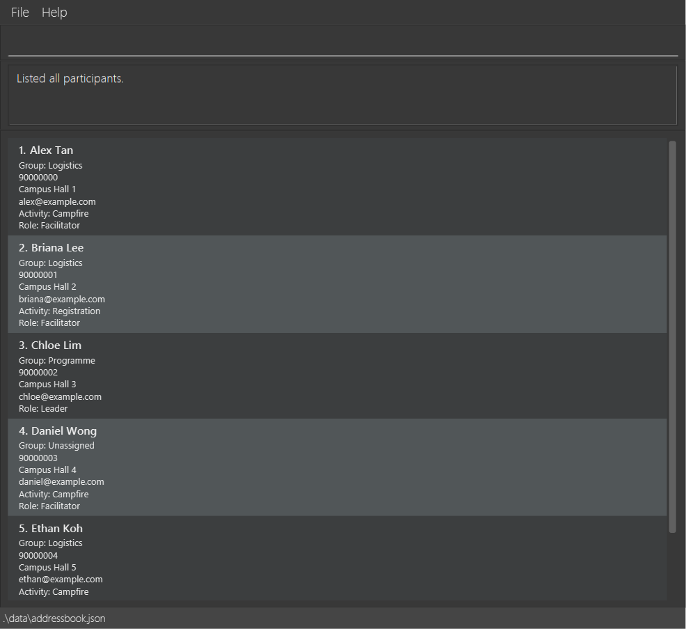

ZoomAddress is a **desktop participant-management application for directors of large-scale computing events**. It is optimized for keyboard-driven commands while retaining the benefits of a graphical interface, allowing event directors to manage participant records quickly and locally.

* Table of Contents
{:toc}

--------------------------------------------------------------------------------------------------------------------

## Quick start

1. Ensure that Java `25` is installed on your computer. 
   **Mac users:** Ensure you have the precise JDK version prescribed [here](https://se-education.org/guides/tutorials/javaInstallationMac.html).

1. Open the [v1.4.1 release](https://github.com/AY2627S1-CS2103T-W13-2/tp/releases/tag/v1.4.1) and download the JAR matching your **Java runtime architecture**:
   * Windows x64, Linux x64 or macOS with x64 Java 25 (including Apple Silicon via Rosetta): `ZoomAddress-v1.4.1.jar`.
   * Apple Silicon macOS with native arm64 Java 25: `ZoomAddress-v1.4.1-mac-aarch64.jar`. **The older v1.4 JAR does not work with native arm64 Java**; do not use it as a fallback.
   * Run `java -XshowSettings:properties -version` and find `os.arch` to check the active Java runtime: `amd64` or `x86_64` means x64; `aarch64` or `arm64` means arm64. Choose by this value, not the Mac's hardware alone.
   * Check the release notes and `SHA256SUMS.txt` for the tested commit, checksums and limitations.

1. Copy the file to the folder you want to use as the _home folder_ for ZoomAddress.

   ZoomAddress writes `data/addressbook.json` relative to the terminal's **working folder**, so run the JAR from
   the same folder each time to reopen the same participant data.

1. Open a terminal, `cd` to the folder containing the JAR file, and use the command matching the file you downloaded:
   * x64 Java: `java -jar ZoomAddress-v1.4.1.jar`.
   * Native arm64 Java on Apple Silicon: `java -jar ZoomAddress-v1.4.1-mac-aarch64.jar`.

   The ZoomAddress window should appear in a few seconds with some sample data.

1. Type a command in the command box and press Enter to execute it. For example, type **`help`** and press Enter to open the help window. 
   Some example commands you can try:

   * `list` : Lists all participants.

   * `sort name` : Sorts the currently displayed participants by name.

   * `add n/John Doe p/98765432 e/johnd@example.com a/John street, block 123, #01-01` : Adds a participant named `John Doe` to ZoomAddress.

   * `delete 3` : Deletes the 3rd participant shown in the current list.

   * `view 3` : Displays all stored details of the 3rd participant shown in the current list.

   * `find-contact 98765432` : Finds participants with the exact phone number `98765432`.

   * `clear` : Deletes all participant records.

   * `exit` : Exits the app.

1. Refer to the [Features](#features) section below for details of each command.

--------------------------------------------------------------------------------------------------------------------

## Features

### Typical event-day workflow

1. Enter `list` to inspect the directory and note the **displayed** index of a participant.
2. Enter `unassigned g/` to see everyone who still needs a group. The result is a new view over all stored
   participants; index `1` now refers to the first participant **in that result**, not necessarily the first
   participant from the original `list`.
3. **If at least one participant is shown**, enter `assign-group 1 g/Logistics` to allocate the first displayed
   participant; otherwise skip this step. Check the returned name before continuing. A successful assignment
   automatically restores the full directory view. You can also enter `list` to restore it at any time.
4. Enter `filter-all g/Logistics r/Facilitator` to find participants who have **both** assignments. If you need
   only one category, use `filter g/Logistics` instead.
5. Enter `sort name` to order the current results by name. Use the indices shown **after** sorting for
   `view`, `edit`, or `delete`. Sorting and filtering change the view, not participant fields.

The screenshots in this guide use synthetic participants from the v1.4 release. They show the application content,
not OS window decorations; fonts may differ by platform.

*A `list` result: each participant card shows its current group, role and activity.*

**:information_source: Notes about the command format:** 

* Words in `UPPER_CASE` are the parameters to be supplied by the user. 
  For example, in `add n/NAME`, replace `NAME` with a value such as `John Doe`.

* Items in square brackets are optional. 
  For example, `n/NAME [t/TAG]` can be used as `n/John Doe t/friend` or as `n/John Doe`.

* Items followed by `…`​ can appear zero or more times. 
  For example, `[t/TAG]…​` may be omitted, or written as `t/friend` or `t/friend t/family`.

* For `add` and `edit`, prefixed fields can be in any order. 
  For example, `p/PHONE_NUMBER n/NAME` is also acceptable when adding a participant. Commands such as `unassign`
  require the displayed index before the assignment prefix.

* Commands that take no parameters, such as `help`, `list`, `exit`, and `clear`, reject extraneous parameters. 
  For example, `help 123` is invalid and the application displays the correct `help` command format.

* If you are using a PDF version of this document, be careful when copying and pasting commands that span multiple lines as space characters surrounding line-breaks may be omitted when copied over to the application.

*Invalid input such as `list extra` shows a command-specific usage message without changing the displayed list.*

ZoomAddress adds `view`, `assign-group`, `assign-role`, `assign-activity`, `unassign`, `unassigned`, `sort`, `filter`, `filter-all`, and
`find-contact` to the original AddressBook-Level3 commands. The other commands below retain their familiar
AddressBook workflow, with participant-focused wording.

### Viewing help: `help`

Opens a window with a link to this ZoomAddress User Guide.

Format: `help`

### Adding a participant: `add`

Adds a participant to ZoomAddress.

Format: `add n/NAME p/PHONE_NUMBER e/EMAIL a/ADDRESS [t/TAG]…​`

:bulb: **Tip:**
A participant can have any number of tags, including zero.

Examples:
* `add n/John Doe p/98765432 e/johnd@example.com a/John street, block 123, #01-01`
* `add n/Betsy Crowe t/friend e/betsycrowe@example.com a/Newgate Prison p/1234567 t/criminal`

### Listing all participants: `list`

Shows a list of all participants in ZoomAddress.

Format: `list`

### Sorting participants by name: `sort`

Sorts the currently displayed participants by name without changing any participant data.

Format: `sort name`

* Names are sorted in ascending alphabetical order using a case-insensitive comparison.
* If two names are equal under the case-insensitive comparison, their exact capitalization is
  used as a deterministic secondary comparison.
* Sorting applies to the current view. For example, after `find Alex`, `sort name` sorts only the
  matching participants.
* The displayed index numbers are updated to match the sorted order. Commands such as `view 1`,
  `edit 1`, and `delete 1` therefore act on the first participant shown after sorting.
* Sorting is a view operation: it does not rewrite participant records or modify their fields.
* The sorted view lasts for the current application session but is not saved. After restarting
  ZoomAddress, enter `sort name` again to restore the sorted view.

Valid example:
* `sort name` sorts `alice`, `Bob`, and `charlie` into that displayed order and shows
  `Sorted participants by name in ascending order.`

Invalid examples:
* `sort` is rejected because the criterion is missing.
* `sort role` is rejected because only the `name` criterion is supported.
* `sort name descending` is rejected because extra arguments are not accepted.

### Viewing a participant: `view`

Displays all stored details of a participant without changing the participant's data.

Format: `view INDEX`

* Displays the participant at the specified `INDEX`.
* The index refers to the index number shown in the displayed participant list.
* The index **must be a positive integer** 1, 2, 3, …​
* Details appear on separate labelled lines. A missing group, role, or activity appears as `Unassigned`.
* Tags are sorted by their names (case-sensitive) and separated by commas; `Tags: (none)` means the participant
  has no tags. A real tag named `None` appears as `Tags: None`. Viewing does not change the participant or the
  current list.
* An empty saved remark appears as `Remark: None`. A present remark is enclosed in double quotes, so the literal
  remark `None` appears as `Remark: "None"`. Quotes, backslashes, and line breaks in present remarks are escaped
  for display; viewing never changes the saved text.

Examples:
* `list` followed by `view 2` displays all stored details of the 2nd participant in ZoomAddress.
* `find Betsy` followed by `view 1` displays all stored details of the 1st participant in the results of the `find` command.
* For a participant named Alice Pauline with no remark, the output includes `Name: Alice Pauline` and ends
  with `Remark: None`. A saved remark such as `Needs wheelchair access` appears as
  `Remark: "Needs wheelchair access"`.

### Editing a participant: `edit`

Edits an existing participant in ZoomAddress.

Format: `edit INDEX [n/NAME] [p/PHONE] [e/EMAIL] [a/ADDRESS] [t/TAG]…​`

* Edits the participant at the specified `INDEX`. The index refers to the index number shown in the displayed participant list. The index **must be a positive integer** 1, 2, 3, …​
* At least one of the optional fields must be provided.
* Existing values will be updated to the input values.
* When editing tags, all of the participant's existing tags are removed; adding tags is not cumulative.
* To remove all of a participant's tags, enter `t/` without a tag after it.

Examples:
*  `edit 1 p/91234567 e/johndoe@example.com` Edits the phone number and email address of the 1st participant to be `91234567` and `johndoe@example.com` respectively.
*  `edit 2 n/Betsy Crower t/` Edits the name of the 2nd participant to be `Betsy Crower` and clears all existing tags.

### Assigning an activity: `assign-activity`

Assigns one activity to an existing participant and displays it on their card.

Format: `assign-activity INDEX a/ACTIVITY`

* `INDEX` is the positive integer shown beside the participant in the current list. After `find`, use the index in the search results.
* Each participant can have at most one activity. Assigning another activity replaces the previous assignment.
* `ACTIVITY` must not be blank. Names can contain spaces and punctuation; surrounding whitespace is removed.
* Supply `a/` exactly once. In this command it means activity; in `add` and `edit`, it still means address.
* The assignment is saved automatically and retained after restarting or editing the participant's other details. Assigning or replacing an activity preserves their role; assigning or replacing a role preserves their activity.
* Records created before activity assignments were introduced start without an activity. Multiple activities and
  attendance are not supported yet.

Examples:
* `assign-activity 1 a/Campfire` assigns Campfire to the first participant in the displayed list.
* `assign-activity 1 a/Arts & Crafts` replaces that participant's activity with Arts & Crafts.

### Assigning a role to a participant: `assign-role`

Assigns one event role to an existing participant.

Format: `assign-role INDEX r/ROLE`

* Assigns the role to the participant at the specified `INDEX` in the displayed participant list.
* The index **must be a positive integer** 1, 2, 3, …​ and refer to a displayed participant.
* The role must contain at least one non-whitespace character.
* Assigning another role to the same participant replaces the existing role.

Example:
* `assign-role 2 r/Logistics Lead` assigns the role `Logistics Lead` to the second displayed participant.

### Assigning a participant to a group: `assign-group`

Assigns one group to an existing participant.

Format: `assign-group INDEX g/GROUP`

* Assigns the participant at the specified `INDEX` to `GROUP`.
* The index refers to the index number shown in the displayed participant list and must be a positive integer.
* `GROUP` must not be blank and may contain spaces.
* A participant can belong to at most one group. Assigning another group replaces the current group and preserves their role and activity.
* Managing a separate list of groups is not supported yet.

Example:
* `assign-group 2 g/Logistics` assigns the second displayed participant to the `Logistics` group.

### Clearing an assignment: `unassign`

Clears one group, role, or activity assignment from an existing participant.

Format: `unassign INDEX g/` or `unassign INDEX r/` or `unassign INDEX a/`

* `INDEX` must be a positive integer from the displayed participant list. After `find` or `sort name`, use the index
  shown in that filtered or sorted view.
* Supply exactly one empty prefix: `g/` for group, `r/` for role, or `a/` for activity. Do not add a value after the prefix.
* Clearing one assignment preserves the participant's name, contact details, tags, and other assignments. The change is saved automatically.
* You cannot clear an assignment that is already absent.
* On success, ZoomAddress names the removed value, for example,
  `Cleared group assignment 'Logistics' for Beth Lee.`

Examples:
* `unassign 2 g/` clears the group assigned to the second displayed participant.
* `unassign 2 r/` clears their role.
* `unassign 2 a/` clears their activity.

Invalid examples and responses:

| Command | Response |
|---|---|
| `unassign` | `Please provide a participant index before the assignment prefix.` |
| `unassign abc g/` | `Index must be a positive integer.` |
| `unassign 99 g/` | `The participant index provided is invalid.` if fewer than 99 participants are displayed. |
| `unassign 2` | `Please specify exactly one assignment prefix: g/, r/, or a/.` |
| `unassign 2 g/ r/` | `Specify only one assignment prefix: g/, r/, or a/.` |
| `unassign 2 g/ g/` | `Assignment prefix must not be repeated: g/` |
| `unassign 2 x/` | `Unsupported assignment prefix: x/ Use g/, r/, or a/.` |
| `unassign 2 g/Logistics` | `The g/ prefix must not contain a value when clearing the group assignment.` |
| `unassign 2 unexpected g/` | `Unexpected extra argument(s): unexpected g/` |

If Beth Lee has no group assignment, `unassign 2 g/` reports `Beth Lee has no group assignment to clear.`

### Filtering participants by assignment: `filter`

Filters the displayed participant list to one exact group, role, or activity. This helps event directors quickly find
everyone sharing an assignment during event operations.

Formats:
* `filter g/GROUP`
* `filter r/ROLE`
* `filter a/ACTIVITY`

* Begin with exactly one of `g/`, `r/`, or `a/`. Missing, repeated, or multiple supported prefixes are rejected with a
  specific error. Text before the assignment prefix is also rejected. An embedded slash such as in `Tech/Media` is
  ordinary value text, but a separate `g/`, `r/`, or `a/` token is treated as another prefix.
* Matching is case-insensitive and ignores leading and trailing whitespace. It remains exact after that normalisation:
  `filter g/Logistics` does not match `Logistics Team`.
  This also applies to slash-containing values: `filter g/team a/b` matches a stored group named `Team A/B`.
  If the complete value does not match a stored assignment, a later `g/`, `r/`, or `a/` fragment is reported as a
  repeated or additional assignment prefix.
* To search for a value containing a prefix-like fragment such as `r/Lead` or `a/Campfire`, put the **entire value**
  in double quotes: `filter g/"Team r/Lead"`. Text inside the quotes is literal, so the fragment does not start a
  second criterion. Quotes are not part of the matched value. Inside quotes, use `\"` for a literal double quote and
  `\\` for a literal backslash; other escapes are rejected. An unfinished opening quote or extra text after a closing
  quote gives a specific error. Only a quote at the start of the value begins quoted syntax: quotes elsewhere in an
  unquoted value remain literal, so existing searches such as `filter g/Team "A"` and `filter g/team a/b` still work.
* A stored label whose **first character is a literal double quote** needs an escaped search. For example, a group
  stored as `"Alpha"` (including both quote characters) is found with `filter g/"\"Alpha\""`. By contrast,
  `filter g/"Alpha"` now searches for `Alpha` without quote characters. This is a change from older versions, where
  the latter query searched for the quoted label.
* Participants without the selected assignment are excluded.
* A successful filter displays matching participants with list indices starting from 1. If nothing matches, the list
  is empty and ZoomAddress reports that 0 participants matched.
* Filtering only changes the displayed list. It does not modify, remove, or reorder stored participant data.

Examples:
* `filter g/Logistics` displays all participants assigned to the Logistics group.
* `filter r/facilitator` displays participants whose role is Facilitator, regardless of letter case.
* `filter a/  Campfire  ` displays participants assigned to Campfire after trimming the value.
* `filter g/"Team r/Lead"` displays participants whose group is literally `Team r/Lead`.
* `filter r/"Say \"Hi\" \\ Lead"` matches the literal role `Say "Hi" \ Lead`.
* `filter g/"\"Alpha\""` matches a group whose stored name includes the outer quote characters: `"Alpha"`.

### Filtering by combined assignments: `filter-all`

Shows participants matching **all** of two or three assignment criteria (AND).

Formats:
* `filter-all g/GROUP r/ROLE`
* `filter-all g/GROUP a/ACTIVITY`
* `filter-all r/ROLE a/ACTIVITY`
* `filter-all g/GROUP r/ROLE a/ACTIVITY`

* Criteria may appear in any order. Use two or three distinct lowercase prefixes, each with a non-blank value.
  For this command, `a/` means activity. Use `filter` for one criterion.
* Each selected assignment must match exactly, ignoring letter case and surrounding whitespace. An absent selected
  assignment does not match. Unspecified categories do not restrict the results.
* Searches start from **all stored participants**, replacing earlier searches and filters. `sort name` remains active;
  displayed indices start from 1 and apply to `view`, `edit`, assignment commands, and other index-based commands.
* No matches (including an empty directory) gives an empty list and `0 participant(s) matched all assignments.`
* Participant fields and stored order are unchanged. The filter is session-only; `list` restores the full sorted view,
  while restarting restores stored order.

**Values and quoting:**

* Unquoted values can contain spaces and embedded slashes, for example `g/Logistics Team` or `g/Tech/Media`.
* Outside quotes, a token beginning with letters followed by `/` after whitespace starts a new prefix. Quote the
  **whole value** when such text belongs to the label: `g/"Team A/B"` or `g/"Team r/Lead"`. This rule applies regardless
  of case; an unsupported prefix such as `A/`, `R/`, or `p/` produces an error.
* Inside double quotes, prefix-like text is literal. Use `\"` for a literal double quote and `\\` for a literal
  backslash. Other escapes are rejected. Unquoted backslashes are literal.
* Close every quoted value, then use whitespace before the next prefix. Partial quoting and text after a closing
  quote are rejected. Quotes are query syntax and are not part of the matched label.
* These quoting rules also apply to a **quoted** value in `filter`. Existing unquoted searches remain supported:
  `filter g/team a/b` still matches a stored group named `Team A/B`, and unquoted quote characters remain literal.

Examples:
* `filter-all g/Logistics r/Facilitator` matches participants who are both in Logistics and Facilitators.
* `filter-all a/campfire r/FACILITATOR g/logistics` also requires the Campfire activity.
* `filter-all g/"Team A/B" r/Facilitator` matches the literal group label `Team A/B` and role Facilitator.
* `filter-all g/"Team r/Lead" r/"Say \"Hi\" \\ Lead"` matches group `Team r/Lead` and role `Say "Hi" \ Lead`.

*A `filter-all g/Logistics r/Facilitator` result: only participants satisfying both criteria remain visible.*

Common invalid inputs:

| Input | Error and correction |
|---|---|
| `filter-all g/Logistics` | `Specify two or three distinct assignment prefixes: g/, r/, a/.` Add another criterion or use `filter`. |
| `filter-all g/Logistics g/Other` | `Assignment prefix must not be repeated: g/` Use each category once. |
| `filter-all g/ r/Lead` | `Assignment values must not be blank.` Supply a value for every prefix. |
| `filter-all g/Logistics R/Lead` | `Unsupported assignment prefix: R/ Use g/, r/, or a/.` Use lowercase prefixes. |
| `filter-all extra g/Logistics r/Lead` | `Expected an assignment prefix: g/, r/, or a/.` Remove the preamble. |
| `filter-all g/"Team r/Lead` | `Unfinished quoted value. Close the double quote.` Close the value and supply another criterion. |
| `filter-all g/"Team\q" r/Lead` | `Unsupported escape.` Use only escaped quotes or backslashes inside quotes. |
| `filter-all g/Team"X" r/Lead` | `Quote the entire assignment value, not just part of it.` Enclose the whole value. |
| `filter-all g/"Team"r/Lead` | `Expected whitespace or end of input after a quoted value.` Add a space between criteria. |

Invalid queries leave the current view and participant data unchanged.

The same quote-boundary errors apply to `filter`: `filter g/"Team r/Lead` is unfinished, `filter g/"Team\q"`
contains an unsupported escape, and `filter g/"Team"r/Lead` needs whitespace after the closing quote. A second
prefix **outside** a complete quoted value, such as `filter g/"Team r/Lead" r/Other`, is rejected rather than treated
as part of the group name.

### Finding incomplete allocations: `unassigned`

Shows participants who have no group, role, or activity assignment in one selected category.

Formats: `unassigned g/`, `unassigned r/`, or `unassigned a/`.

* Use exactly one empty, lowercase prefix. Do not include an index, assignment value, quotes, or other arguments.
  For this command, `a/` means activity, not address.
* The query considers **all stored participants**, even after another search or filter. It replaces the previous
  filter rather than narrowing it. An active `sort name` order is preserved, and displayed indices start from 1.
* Only the selected field must be absent; other assignments do not affect the result. A stored label literally
  named `Unassigned` is still an assignment and is not treated as missing.
* No participant fields or stored ordering change. The view itself is not saved; use `list` to show everyone again.
* If nobody matches (including an empty directory), the displayed list is empty and the response is
  `0 participant(s) have no group assignment.` for `unassigned g/` (or the selected role/activity category).

Examples:

* `unassigned g/` shows everyone who still needs a group allocation.
* `unassigned r/` shows everyone without a role, regardless of their group or activity.
* `unassigned a/` shows everyone without an activity. Use the resulting displayed index for `view`, `assign-activity`,
  `edit`, or other index-based commands.

*An `unassigned g/` result: a participant may still have a role or activity while lacking a group.*

Common invalid inputs:

| Input | Error and correction |
|---|---|
| `unassigned` | `Please specify exactly one empty assignment prefix: g/, r/, or a/.` Choose one category. |
| `unassigned g/ r/` | `Specify only one assignment prefix: g/, r/, or a/.` Run separate queries instead. |
| `unassigned g/ g/` | `Assignment prefix must not be repeated: g/` Remove the duplicate. |
| `unassigned g/Logistics` | `The g/ prefix must not contain a value for an unassigned query.` Use `unassigned g/` (or `filter g/Logistics` to find assigned participants). |
| `unassigned G/` | `Unsupported assignment prefix: G/ Use g/, r/, or a/.` Use lowercase `g/`. |
| `unassigned g/ extra` | `Unexpected extra argument(s). Use unassigned g/, unassigned r/, or unassigned a/.` Remove the extra text. |

### Locating participants by name: `find`

Finds participants whose names contain any of the given keywords.

Format: `find KEYWORD [MORE_KEYWORDS]`

* The search is case-insensitive; for example, `hans` matches `Hans`.
* Keyword order does not matter; for example, `Hans Bo` matches `Bo Hans`.
* The search considers only names.
* Only full words match; for example, `Han` does not match `Hans`.
* Participants matching at least one keyword are returned (an `OR` search); for example, `Hans Bo` returns `Hans Gruber` and `Bo Yang`.

Examples:
* `find Alex` returns `Alex Yeoh` in the initial sample data.
* `find alex david` returns `Alex Yeoh` and `David Li`. Search results use the same
  participant-card layout as the current directory screenshot below, including
  each participant's group. The screenshot illustrates the layout, not this specific
  search result.

### Locating participants by contact information: `find-contact`

Finds participants whose complete phone number or email address matches the given value.

Format: `find-contact PHONE_OR_EMAIL`

* Provide exactly one valid phone number or email address. Surrounding ordinary spaces, tabs and Unicode
  whitespace such as U+2003 EM SPACE or U+3000 IDEOGRAPHIC SPACE are ignored.
* Internal whitespace is not removed. Non-breaking spaces (including U+00A0) and zero-width characters are not
  ignored; remove these characters if pasted contact text is rejected. Use an ordinary space after `find-contact`.
* Phone numbers are matched exactly. Partial phone numbers do not match.
* Email addresses are matched exactly and case-insensitively. For example, `ALEX@EXAMPLE.COM`
  matches `alex@example.com`.
* The search always considers every stored participant, even if the displayed list was previously filtered.
* The command only filters the displayed list. It does not change or delete participant data.

Examples:
* `find-contact 98765432` finds participants whose phone number is exactly `98765432`.
* `find-contact alex@example.com` finds participants whose email address is `alex@example.com`.
* `find-contact   ALEX@EXAMPLE.COM   ` searches for the same email, ignoring the surrounding spaces and letter case.

The feedback is `N person(s) listed!`, where `N` is the number of matches; no match gives `0 person(s) listed!`
and an empty displayed list. Results are reindexed from 1, so use the new displayed indices for later commands.
For example, `find-contact alex@example.com extra` and `find-contact 9876 5432` are invalid and report
`Contact must be one complete valid phone number or email address.` A blank query shows command usage instead.
Invalid queries leave the displayed list and participant data unchanged.

### Deleting a participant: `delete`

Deletes the specified participant from ZoomAddress.

Format: `delete INDEX`

* Deletes the participant at the specified `INDEX`.
* The index refers to the index number shown in the displayed participant list.
* The index **must be a positive integer** 1, 2, 3, …​
* Deletion happens immediately, with **no confirmation or undo**. Check the name at that displayed index before
  entering `delete` and keep a separate backup of important data.

Examples:
* `list` followed by `delete 2` deletes the 2nd participant in ZoomAddress.
* `find Betsy` followed by `delete 1` deletes the 1st participant in the results of the `find` command.

### Clearing all entries: `clear`

Clears all participant records from ZoomAddress.

Format: `clear`

`clear` takes effect immediately, with **no confirmation or undo**. Back up `data/addressbook.json` before using it
on a directory you need to keep.

### Exiting the program: `exit`

Exits the program.

Format: `exit`

### Saving the data

ZoomAddress automatically saves data after every successful command. You do not need to save manually.

Participant saves first prepare the complete JSON and write it to a temporary file in the data folder. The previous
file is replaced only through an atomic filesystem move; ZoomAddress does not fall back to truncating the data file
if atomic replacement is unsupported. For an existing file, a temporary recovery copy is kept until replacement
succeeds. Existing participant and assignment fields retain their format.

Participant records also support an optional text `remark` field. Older data files with no `remark`, or a JSON
`null` remark, load with empty remark text; reading does not rewrite the file. A later successful save writes the
remark as a JSON string, including `""` for no remark. Existing edit, assignment and unassignment commands preserve
this text. This storage increment does not yet add a remark command or show remarks on participant cards.
Numbers, booleans, arrays and objects are not valid remark values. If you manually edit the data file, enclose
remark text in JSON double quotes; otherwise ZoomAddress refuses to load that file without rewriting it.
Restore a known-good backup or correct the invalid value before reopening the application.
Keep a backup before changing application versions: older JARs do not preserve the new remark field and can discard
it when saving, even if they can open the rest of the participant data.

If preparing the participant snapshot or serializing it fails, ZoomAddress reports a save error before creating
temporary files or replacing the saved file.

If a save error appears:

* Check the data folder's write permissions, available disk space, and filesystem support for atomic moves.
* A command may already have changed the displayed data before saving failed. The error does **not** mean the
  in-memory change was undone or saved. Keep the application open while investigating the error.
* If atomic replacement is unsupported, the save fails and the original file is left untouched; ZoomAddress does
  not attempt restoration or fall back to a non-atomic write.
* For other replacement failures where the destination may have changed, ZoomAddress attempts to restore the
  previous file atomically if a complete recovery copy was created. If restoration also fails, the error identifies
  a `.zoomaddress-save-*.bak` recovery file containing the previous saved bytes. Preserve that file before retrying
  or restarting; automatic restoration is not guaranteed in this case.
* Temporary files are normally removed. If cleanup fails, their locations are recorded in the application log.
  A `.tmp` file may contain incomplete data and must not be used as a recovery copy. Treat `.bak` files as private
  participant data. A retained recovery copy is not automatically loaded or removed on a later save.

These guarantees apply to participant saves with one application writing the data file. They do not cover
simultaneous external edits, power loss, filesystem corruption, or user-preference saves.

### Editing the data file

ZoomAddress data is saved automatically as a JSON file `data/addressbook.json` relative to the folder where you run
the `java -jar` command. The Quick Start steps make that folder the JAR file's location. Advanced users can update
data directly by editing the JSON file.

:exclamation: **Caution:**
If the existing participant file is unreadable or contains malformed JSON, a `null` document, or invalid values,
ZoomAddress shows a startup error instead of opening an editable empty directory. The error identifies the data-file
path and explains how to recover. ZoomAddress does not change the participant file on a failed start. Back up the
file first, then correct the JSON or read permissions, or restore a known-good copy before restarting. Do not run
commands against an assumed empty directory or delete the original file as a recovery step. 
If the data file is genuinely absent on first launch, ZoomAddress still opens with sample participants. Editing JSON
directly can also cause unexpected behavior when values fall outside the supported range; edit it only if you are
confident you can restore a valid copy.

--------------------------------------------------------------------------------------------------------------------

## FAQ

**Q**: How do I transfer my data to another computer? 
**A**: Close the app on both computers. Copy `data/addressbook.json` from the folder where you ran the old JAR to
the corresponding `data` folder on the new computer. Keep a backup of the destination file before replacing it,
then launch ZoomAddress from that folder. Use a release JAR compatible with the new computer's Java architecture.

--------------------------------------------------------------------------------------------------------------------

## Known issues

1. **When using multiple screens**, if you move the application to a secondary screen, and later switch to using only the primary screen, the GUI will open off-screen. The remedy is to delete the `preferences.json` file created by the application before running the application again.
2. **If you minimize the Help Window** and then run the `help` command (or use the `Help` menu, or the keyboard shortcut `F1`) again, the original Help Window will remain minimized, and no new Help Window will appear. The remedy is to manually restore the minimized Help Window.

--------------------------------------------------------------------------------------------------------------------

## Command summary

Action | Format, Examples
--------|------------------
**Add** | `add n/NAME p/PHONE_NUMBER e/EMAIL a/ADDRESS [t/TAG]…​`   e.g., `add n/James Ho p/22224444 e/jamesho@example.com a/123, Clementi Rd, 1234665 t/friend t/colleague`
**Assign role** | `assign-role INDEX r/ROLE`  e.g., `assign-role 2 r/Logistics Lead`
**Assign group** | `assign-group INDEX g/GROUP`  e.g., `assign-group 2 g/Logistics`
**Clear** | `clear`
**Assign activity** | `assign-activity INDEX a/ACTIVITY`  e.g., `assign-activity 1 a/Campfire`
**Clear assignment** | `unassign INDEX g/` or `unassign INDEX r/` or `unassign INDEX a/`  e.g., `unassign 2 g/`
**Delete** | `delete INDEX`  e.g., `delete 3`
**Edit** | `edit INDEX [n/NAME] [p/PHONE_NUMBER] [e/EMAIL] [a/ADDRESS] [t/TAG]…​`  e.g., `edit 2 n/James Lee e/jameslee@example.com`
**Find** | `find KEYWORD [MORE_KEYWORDS]`  e.g., `find James Jake`
**Find by contact** | `find-contact PHONE_OR_EMAIL`  e.g., `find-contact alex@example.com`
**Filter by assignment** | `filter g/GROUP` or `filter r/ROLE` or `filter a/ACTIVITY`  e.g., `filter g/Logistics`
**Filter by combined assignments** | `filter-all g/GROUP r/ROLE [a/ACTIVITY]` (any two or three categories)  e.g., `filter-all g/Logistics r/Facilitator`
**Find incomplete allocations** | `unassigned g/` or `unassigned r/` or `unassigned a/`
**List** | `list`
**Sort** | `sort name`
**View** | `view INDEX`  e.g., `view 3`
**Help** | `help`
